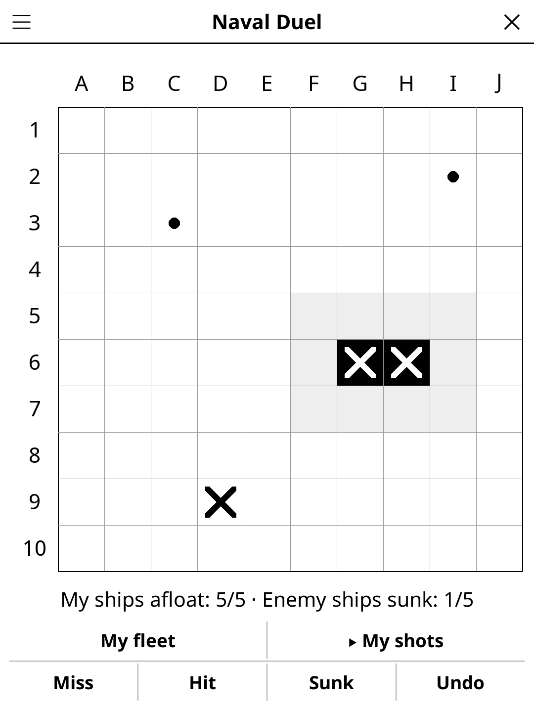

# navalduel.koplugin

**Naval Duel** (*Bataille navale à deux*) is a battleship game for
[KOReader](https://github.com/koreader/koreader), played by two people with a
reader each. The two readers never talk to each other: shots are called
aloud, and each reader answers for its own fleet.

## How to play

1. Both players open Naval Duel and agree on the grid size and on whether
   ships may touch (menu ☰).
2. Each one places a fleet: it starts at random (**Shuffle** deals another);
   tap a ship, then a cell to move it, or the ship again to turn it. Tap
   **Start battle** and hide your screen.
3. Take turns calling a cell, such as "C7":
   - the player being shot at taps that cell under **My fleet**, then
     **Fire**: the reader says miss, hit, or hit and sunk, and they read it out;
   - the shooter taps the same cell under **My shots**, then **Miss**,
     **Hit** or **Sunk**.
4. The first to sink the whole enemy fleet wins.

## Features

- **Honest answers** — the reader of the player being shot at checks the
  shot against the hidden fleet, so no answer is ever wrong.
- **Tracking grid** — misses, hits and sunk ships; when ships may not
  touch, the water around a sunk ship is greyed out for you.
- **Two grids** — 8×8 (ships of 4, 3, 3, 2, 2) or 10×10 (5, 4, 3, 3, 2).
- **Undo** — takes back the last thing you entered, on either grid.
- **Auto-save** — the battle resumes where you left it.
- French, Spanish and German translations.

## Why e-ink friendly?

Turn-based, no animation: each tap repaints one grid.

## License

GPL-3.0
